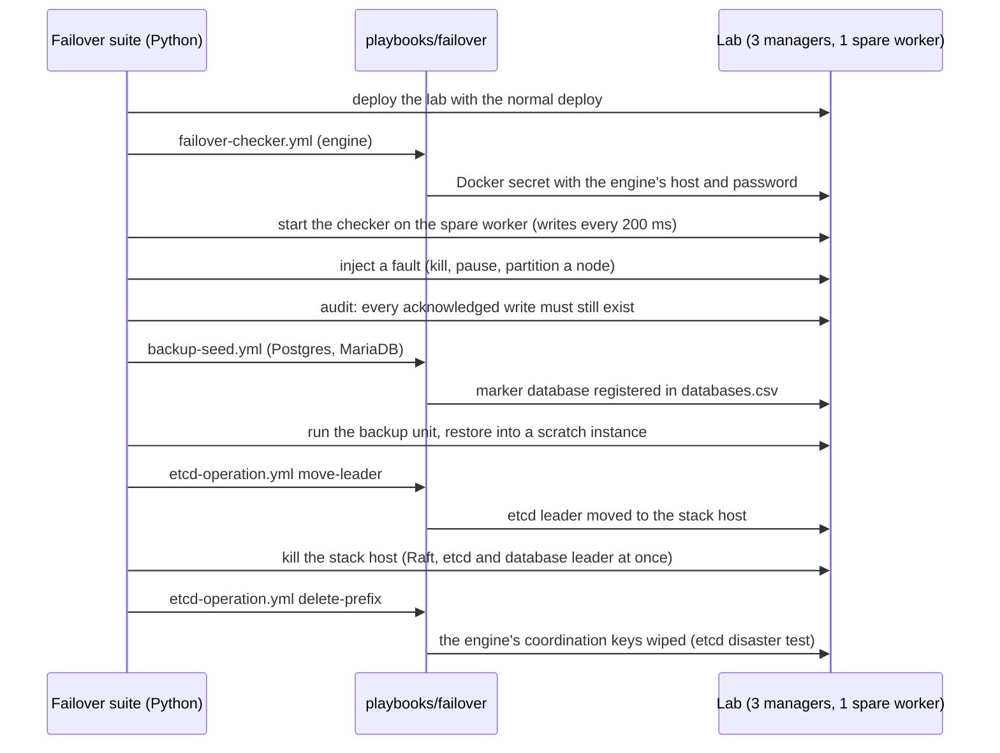

# Failover suite 🧪

These three playbooks are tools of the database failover suite ([`utils/failover`](../../utils/failover/__main__.py), started by [`make test-swarm-data`](../../scripts/tests/deploy/swarm/data/run.sh) and the `call-test-swarm-data` workflow).
They run only in the suite's throwaway Swarm lab, never in a production deploy.

## Why separate playbooks 🤔

The suite is a Python program. It deploys a lab with the normal deploy, then has to do a few things the deploy never does, at a moment only the suite knows:

- give a test client the database password,
- register a test database for the backup,
- push etcd into a state it would not reach on its own.

Each of these needs Ansible (the inventory, the vault password and `lookup('config', …)` to read the lab's secrets), but none of them belongs in a role: a role describes how production should look, while these are test steps.
So the suite calls them as small stand-alone playbooks, with `--limit` and extra vars it builds itself ([`playbook_argv`](../../utils/failover/inventory.py)).

## How a run uses them 🗺️

## The playbooks 📄

| Playbook | What it does | Used by |
|---|---|---|
| [failover-checker.yml](failover-checker.yml) | Creates the Docker secret the write-continuity checker reads: host, port, user and password of one engine. | Every scenario. |
| [backup-seed.yml](backup-seed.yml) | Adds the suite's marker database to the backup's `databases.csv` with `baudolo-seed`, so the next backup run dumps it. | The backup and restore scenario. |
| [etcd-operation.yml](etcd-operation.yml) | `move-leader` hands the etcd leadership to a chosen member; `delete-prefix` deletes one engine's keys. | Losing the stack host with every leader on it; etcd disaster recovery. |

In production, the backup unit dumps every database already listed in `databases.csv`, which the deploy seeds; nothing here is needed there.
