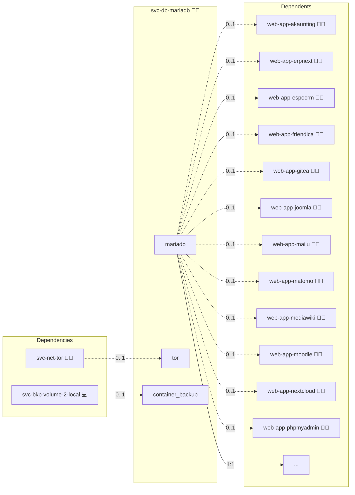

# MariaDB

## Description

The Docker MariaDB Role offers an easy and efficient way to deploy a MariaDB server inside a Docker container. Manage your data securely and effectively, making it ideal for production or local development.

## Overview

This Ansible role facilitates the deployment of a MariaDB server using Docker. It is designed to ensure ease of installation and configuration, with the flexibility to adapt to different environments.

## Cosmos

The diagram places MariaDB in the Infinito.Nexus cosmos: the components it deploys (capabilities), the central services it consumes (dependencies), and its outward reach (federation and bridged external networks).



Solid `1:1` edges are fixed relationships; dashed `0..1` edges are conditional (enabled only in matching deployments); red `0..0` edges are turned off in this role. Node markers show the role's deploy modes (💻 host, 🐳 compose, 🐝 swarm); ❌ marks a service that is explicitly turned off, and ⚙️ an Ansible role dependency declared in `meta/main.yml`.

## Features

- **Dockerized MariaDB**: Leverages Docker for MariaDB deployment, ensuring consistency across different environments.
- **Customizable Settings**: Allows customization of the MariaDB instance through various Ansible variables.
- **Network Configuration**: Includes setup of a dedicated Docker network for MariaDB.
- **Idempotent Design**: Ensures that repeat runs of the playbook do not result in unwanted changes.
- **Security Focused**: Implements best practices for securing the MariaDB root password.

## Quick Setup

### Development

Clone, set up the workstation, and deploy MariaDB onto the local stack:

```bash
git clone https://github.com/infinito-nexus/core.git
cd core
make onboard
make compose-deploy mode=reinstall apps=svc-db-mariadb full_cycle=false
```

### Production

Run the published image to provision the inventory and deploy MariaDB to a managed server (the mounted volume persists the inventory):

```bash
APP=svc-db-mariadb
HOST=<your-server>
DOMAIN=<your-domain>
TLS_MODE=self_signed
SSH_PUBLIC_KEY="<your-ssh-public-key>"

docker run --rm -it \
  -v "$PWD/inventories:/etc/infinito.nexus/inventories" \
  -e APP="$APP" -e HOST="$HOST" -e DOMAIN="$DOMAIN" -e TLS_MODE="$TLS_MODE" -e SSH_PUBLIC_KEY="$SSH_PUBLIC_KEY" \
  ghcr.io/infinito-nexus/core/debian bash -c '
    INVENTORY=/etc/infinito.nexus/inventories/production
    infinito administration inventory provision "$INVENTORY" \
      --inventory-file "$INVENTORY/devices.yml" \
      --host "$HOST" \
      --include "$APP" \
      --vars "{\"TLS_MODE\": \"$TLS_MODE\", \"DOMAIN_PRIMARY\": \"$DOMAIN\", \"users\": {\"administrator\": {\"authorized_keys\": [\"$SSH_PUBLIC_KEY\"]}}}" &&
    infinito administration deploy dedicated "$INVENTORY/devices.yml" \
      --password-file "$INVENTORY/.password" \
      --diff -vv'
```

## Prerequisites

Before using this role, ensure you have the following:

- Ansible installed on the control machine.
- Docker installed on the target host(s).
- Access to the target host(s) via SSH.

## Configuration

Configure the role by setting the required variables. These can be set in the playbook or in a separate variable file:

- `central_mariadb_root_password`: The root password for the MariaDB server.
- `database_name`: The name of the initial database to create.
- `database_username`: The username for the database user.
- `database_password`: The password for the database user.

## High Availability (alpha)

Listing three hosts in the `svc-db-mariadb` inventory group under Swarm renders the HA form: one instance per host (`mariadb-<host-id>`), pinned to it, behind an HAProxy write endpoint that keeps the `mariadb` service name. One host, or Compose, keeps the standalone form unchanged, with binary logging off. The HA form is **alpha**.

| Event | Acknowledged writes | Writes |
|---|---|---|
| One node lost | none lost | resume once the next writer holds the lease |
| Both replicas lost | none lost | stall until a replica returns |

Trade-off: no acknowledged write is lost when one node is lost, because a commit returns only after a replica has the transaction (semi-sync `AFTER_SYNC` with a maximal timeout). The price is that losing both replicas stops writes instead of silently continuing asynchronously and losing them later.

How it works:

- Every instance runs the shared writer elector as a second process under `tini`. It holds an etcd lease (15 s, renew deadline 10 s, retry 2 s) under `/infinito/mariadb/` as the `mariadb-elector` etcd user. On winning, it keeps the lease only if its instance has the most advanced GTID position among reachable peers (ties broken by host-id), waits until its relay log is applied, stops replication and sets `read_only=0`. On losing the lease, missing the renew deadline or SIGTERM it sets `read_only=1` first, then releases the lease. Followers point themselves at the writer with `CHANGE MASTER TO … MASTER_USE_GTID=slave_pos`.
- HAProxy checks each elector's `GET /writer` (port `services.mariadb.ports.internal.writer`) and routes only to the writer.
- If the elector exits, mariadbd is stopped and the task restarts with the profile's `read_only=1`.
- A stopping writer's mariadbd is killed, not shut down cleanly: a clean shutdown would commit the transactions still waiting for an acknowledgement. It restarts as a replica (`init_rpl_role = SLAVE`), so crash recovery truncates them, like Patroni's `pg_rewind`.
- A follower whose replication stays on error 1236 for 60 s (it holds transactions the writer lacks, or the writer purged the binary log it needs) restarts, discards its data directory and asks a healthy peer's elector (`POST /seed` on the `/writer` port, HMAC-signed with the replication secret) to stream a `mariadb-backup` to it, replicas before the writer. It then replicates from that peer until its elector points it at the writer. Its discarded GTID position is logged first.
- Server profile: semi-sync `AFTER_SYNC`, `rpl_semi_sync_master_timeout` at its maximum, the semi-sync master side switched on by the elector only on the writer (a replica that logs applied events with `log_slave_updates` would otherwise wait forever for acknowledgements no replica of its own sends), `sync_binlog=1`, `sync_relay_log=1`, `gtid_strict_mode=1`, `log_slave_updates=1`, a file-based binary log and `read_only=1` by default. `server_id` is a hash of the host-id; a collision inside the group fails the deploy.
- The replication user, the elector's SQL user and the elector's etcd password reach the containers as Docker secrets. Application passwords stay in env files.
- Provisioning runs the same idempotent SQL as the standalone form (database, user, grant, `MARIADB_ENCODING` / `MARIADB_COLLATION`) by exec into the writer over its local socket, with credentials from a mounted option file, never on the command line.
- The image and version are the same in both forms, on the role's rolling 13.x pin. There is no downgrade.

Networks: the application-facing `mariadb` overlay is joined only by HAProxy. The instances, HAProxy and the elector's `/writer` live on the stack-scoped, encrypted `internal` overlay (`meta/networks.yml` `internal.subnet`); the instances also join the etcd overlay. No port is published. HAProxy runs the official image as its non-root user with a read-only root filesystem, no stats page and a local admin socket.

Exceptions to the hardening baseline: the elector runs as root inside the MariaDB container, because it shares the container with the entrypoint that must stop mariadbd when the elector exits, and because its Docker secrets (mode `0400`) are owned by root; `compose_volumes` cannot set a secret's uid. The MariaDB root filesystem stays writable, as in the standalone form. The replication and elector SQL users are still created as `@'%'`; the internal overlay, not the grant, bounds where they connect from.

Sizing: one instance reserves 2 GiB (limit 4 GiB), the elector included. The per-node arithmetic for all engines is in the `svc-db-postgres` README: ≈ 8 GiB reserved per node before applications, 16 GiB minimum.

### Alternatives considered

replication-manager (redundant arbitration is a paid feature, no fencing), MaxScale (the free line is frozen, later lines are licensed), Orchestrator (archived upstream) and Galera (restricts applications: primary keys for `DELETE`, no `LOCK TABLES`) were rejected; the full reasoning lives with the database HA requirement.

### Runbooks

- **Migrating from standalone:** add hosts to `svc-db-mariadb` and re-run. The original host's instance restarts once into the HA profile on the legacy volume (this turns on binary logging and GTID), bootstraps the replication users, wins the lease, and the new instances are seeded from it. Expect a short planned write outage. Going back to standalone in place is not supported; use backup and restore.
- **Adding or replacing an instance:** list the host and re-run. An instance with an empty volume waits for a seed: Ansible streams a `mariadb-backup` from a healthy replica (the writer if none is), sets `gtid_slave_pos`, runs `CHANGE MASTER TO … MASTER_USE_GTID=slave_pos` and waits until it has caught up. Only then does its elector compete.
- **Changing the root password:** the scale-to-zero reset is refused in the HA form. Run `ALTER USER` for `'root'@'localhost'` and `'root'@'%'` on the writer (it replicates), update the inventory credential and re-run.
- **Rolling upgrade or restart-requiring change:** an image change is rolled by the deploy itself: before the stack deploy, `sys-svc-compose` moves the replicas to the new image one at a time, each converged and healthy before the next, then the old writer last; its SIGTERM turns it read-only and releases the lease, and the most advanced replica takes over. For any other restart-requiring change do the same by hand: replicas first, then `docker service update --force` on the writer's service.
- **Both replicas down:** writes stall by design. Bring one replica back; writes resume when it acknowledges.

## Contributing

Contributions to this project are welcome. Please submit issues and pull requests with your suggestions.

## Further Resources

- [Reset Password for MariaDB/MySQL in Docker](https://wolfgang.gassler.org/reset-password-mariadb-mysql-docker/)

## Credits

Implemented by **[Kevin Veen-Birkenbach](https://www.veen.world)**.
Part of the [Infinito.Nexus Project](https://s.infinito.nexus/code) and maintained by [Kevin Veen-Birkenbach](https://www.veen.world).
Licensed under the [Infinito.Nexus Community License (Non-Commercial)](https://s.infinito.nexus/license).
