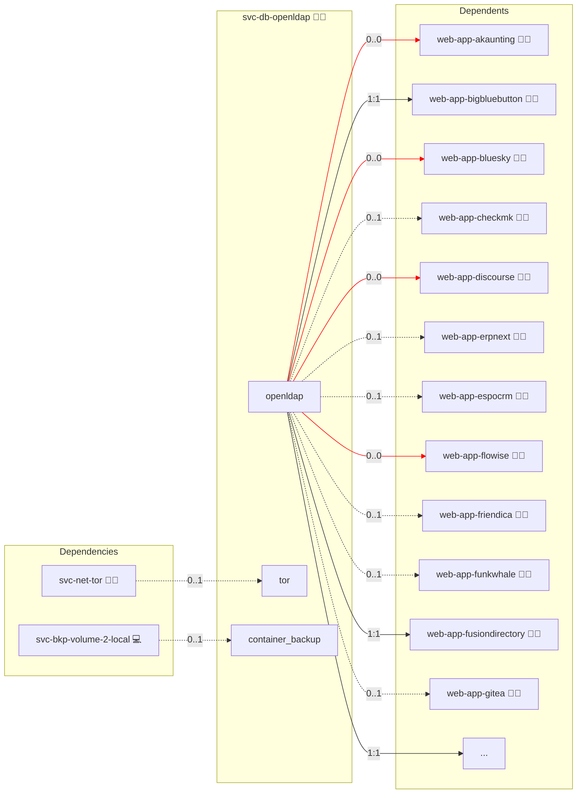

# OpenLDAP

## Description

Unleash the potential of centralized identity management with [OpenLDAP](https://www.openldap.org/). This powerful directory service provides a robust platform for managing users, groups, and organizational units while ensuring secure, scalable, and efficient authentication and authorization.

## Overview

Deploy OpenLDAP in a Docker environment with support for TLS-secured communication via an NGINX stream proxy. OpenLDAP offers advanced directory management capabilities, including flexible schema definitions, dynamic configuration overlays, and comprehensive query support with LDAP search utilities.

## Cosmos

The diagram places OpenLDAP in the Infinito.Nexus cosmos: the components it deploys (capabilities), the central services it consumes (dependencies), and its outward reach (federation and bridged external networks).



Solid `1:1` edges are fixed relationships; dashed `0..1` edges are conditional (enabled only in matching deployments); red `0..0` edges are turned off in this role. Node markers show the role's deploy modes (💻 host, 🐳 compose, 🐝 swarm); ❌ marks a service that is explicitly turned off, and ⚙️ an Ansible role dependency declared in `meta/main.yml`.

## Features

- **Centralized Identity Management:** Maintain a unified repository for all users and groups with robust organizational structures.
- **Flexible Schema Support:** Customize and extend directory schemas to meet diverse organizational requirements.
- **Secure Communications:** Enable TLS encryption for data in transit when accessed through an NGINX reverse proxy.
- **Dynamic Configuration:** Leverage runtime configuration overlays to adjust directory settings without downtime.
- **Comprehensive Query Capabilities:** Utilize LDAP search tools to efficiently query and manage directory data.
- **High Performance and Scalability:** Designed to handle large-scale deployments with rapid lookup and authentication response times.

## Quick Setup

### Development

Clone, set up the workstation, and deploy OpenLDAP onto the local stack:

```bash
git clone https://github.com/infinito-nexus/core.git
cd core
make onboard
make compose-deploy mode=reinstall apps=svc-db-openldap full_cycle=false
```

### Production

Run the published image to provision the inventory and deploy OpenLDAP to a managed server (the mounted volume persists the inventory):

```bash
APP=svc-db-openldap
HOST=<your-server>
DOMAIN=<your-domain>
TLS_MODE=self_signed
SSH_PUBLIC_KEY="<your-ssh-public-key>"

docker run --rm -it \
  -v "$PWD/inventories:/etc/infinito.nexus/inventories" \
  -e APP="$APP" -e HOST="$HOST" -e DOMAIN="$DOMAIN" -e TLS_MODE="$TLS_MODE" -e SSH_PUBLIC_KEY="$SSH_PUBLIC_KEY" \
  ghcr.io/infinito-nexus/core/debian bash -c '
    INVENTORY=/etc/infinito.nexus/inventories/production
    infinito administration inventory provision "$INVENTORY" \
      --inventory-file "$INVENTORY/devices.yml" \
      --host "$HOST" \
      --include "$APP" \
      --vars "{\"TLS_MODE\": \"$TLS_MODE\", \"DOMAIN_PRIMARY\": \"$DOMAIN\", \"users\": {\"administrator\": {\"authorized_keys\": [\"$SSH_PUBLIC_KEY\"]}}}" &&
    infinito administration deploy dedicated "$INVENTORY/devices.yml" \
      --password-file "$INVENTORY/.password" \
      --diff -vv'
```

## User Password Update Policy

By default, LDAP user passwords are updated on every deployment run.

To set a password only once (on initial user creation), set this flag per user:

```yaml
users:
  alice:
    password: "..."
    password_update: false
```

With `password_update: false`, existing LDAP users keep their current password on later runs.

## High Availability on Swarm (alpha)

Listing three or more Swarm nodes in the `svc-db-openldap` inventory group renders the HA form. One host keeps the standalone form unchanged (no elector, no etcd); two hosts render HA but warn that there is no drain safety.

| Tier | On one node loss | Writes during the gap | Stale writer fence |
|---|---|---|---|
| best-effort | at most 10 s of writes, merged last-writer-wins by `entryCSN` | stop until a new writer is elected | read-only at the renew deadline, 10 s |

How it works:

- Every host runs one instance `openldap-<host-id>`, pinned to its node, with N-way multi-provider syncrepl to every peer (`olcMultiProvider: TRUE`). `memberOf` is excluded from replication; memberof (with `olcMemberOfAddCheck: TRUE`) and refint run on every instance.
- `cn=config` is rendered by Ansible per instance as LDIF and delivered as a versioned Swarm config. The entrypoint rebuilds `slapd.d` from it on every start, so a re-cloned instance configures itself without an Ansible run and always boots with the data database read-only. A configuration change rolls the instance.
- `olcServerID` is a SHA-256 hash of the host-id mapped into 1–4095. The deploy fails when two hosts in the group collide; rename one.
- slapd listens on 1389 as the unprivileged `openldap` user. HAProxy keeps the `openldap` name on port 389, so applications keep `ldap://openldap:389`.
- Each instance runs the writer elector as a second process under `tini`. It competes for an etcd lease (15 s lease, 10 s renew deadline, 2 s retry) only after its initial syncrepl refresh, sets `olcReadOnly: FALSE` over `ldapi` on winning and serves `GET /writer` (200 only while it holds the lease and slapd is writable). If the elector exits, slapd stops and the container restarts read-only.
- The elector's etcd user `openldap-elector` is restricted to `/infinito/openldap/`; its password is delivered as a Docker secret, and the etcd CA as a Docker config.
- Ansible provisions data by piping LDIF into `ldapmodify`/`ldapadd -Y EXTERNAL -H ldapi:///` inside the current writer. `ldapsm` over the network and the host `ldif` bind mount are not used in the HA form.

Fences, in order:

1. the old writer's own read-only switch at the renew deadline;
2. HAProxy marking it down when `/writer` answers 503 or stops answering;
3. a new writer counting only once it holds the lease.

Accepted residual risk: a frozen old writer may accept up to 10 s (the renew deadline) of writes, merged last-writer-wins by `entryCSN`.

Networks and hardening:

- The application-facing `openldap` overlay is joined only by HAProxy. Instances, HAProxy and the elector's `/writer` share the stack-scoped, encrypted `internal` overlay (`meta/networks.yml` `internal.subnet`); the instances also join the etcd overlay. No port is published.
- HAProxy runs the official image as its non-root user with a read-only root filesystem, no stats page and a local admin socket. Exception: it alone sets `net.ipv4.ip_unprivileged_port_start=389`, because it listens on 389; the other engines' endpoints use unprivileged ports and set no sysctl.
- Sizing: one instance reserves 1 GiB (limit 1.5 GiB), the elector included. The per-node arithmetic for all engines is in the `svc-db-postgres` README.

Constraints:

- ppolicy and `olcLastBind` must not be enabled while more than one instance serves: both turn binds into writes that bypass `olcReadOnly`. The deploy asserts this.
- Keycloak's LDAP `connection_pooling` stays `false`; logins fail during the writer gap.
- Custom schemas live in `OPENLDAP_SCHEMAS` (`vars/main.yml`) and are rendered as static LDIF. Migrating refuses, and prints the dropped schema names, when the live `cn=config` holds a schema the rendered configuration would drop.

### Runbooks

- **Migrate from standalone:** add the hosts to the group and re-run. The deploy checks the live schemas, stops the standalone slapd, starts the original host's instance on the legacy volume as the first provider, puts HAProxy under the old name and lets the new instances clone themselves through a syncrepl refresh. This is a short planned write outage, not zero-downtime.
- **Rolling change:** an image change is rolled by the deploy: before the stack deploy, `sys-svc-compose` moves the other instances to the new image one at a time, each converged and healthy before the next, then the writer last; its SIGTERM turns it read-only and releases the lease, and a peer takes over. A `cn=config` change rolls through the stack deploy.
- **Replace a node:** forget the dead node, list the replacement host in the group and re-run; its empty instance clones itself before its elector competes.
- **Back to standalone:** not supported in place; go through backup and restore.

## Developer Notes

For the LDAP variable tree, DN layout, attribute SPOT, and the rules for pairing LDAP attributes with OIDC claims, see [ldap.md](../../docs/contributing/design/iam/ldap.md).

## Further Resources

- [Bitnami OpenLDAP](https://hub.docker.com/r/bitnami/openldap)
- [phpLDAPadmin Documentation](https://github.com/leenooks/phpLDAPadmin/wiki/Docker-Container)
- [LDAP Account Manager](https://github.com/LDAPAccountManager/docker)
- [RBAC Wikipedia](https://de.wikipedia.org/wiki/Role_Based_Access_Control)

## Credits

Implemented by **[Kevin Veen-Birkenbach](https://www.veen.world)**.
Part of the [Infinito.Nexus Project](https://s.infinito.nexus/code) and maintained by [Kevin Veen-Birkenbach](https://www.veen.world).
Licensed under the [Infinito.Nexus Community License (Non-Commercial)](https://s.infinito.nexus/license).
