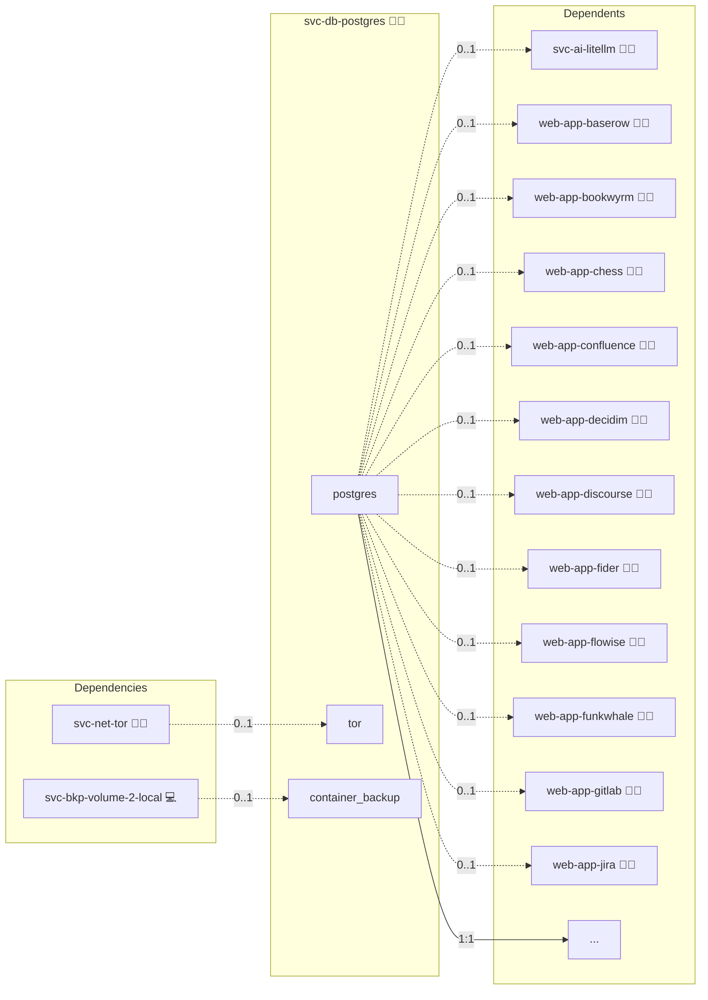

# PostgreSQL

## Description

This Ansible role deploys and configures a PostgreSQL database in a Docker container using Docker Compose. It is designed to simplify database administration by automating the creation of networks, containers, and essential database tasks (such as database and user creation) for a secure and high-performance environment.

## Overview

Built for environments that demand reliability and ease of management, this role:

- Sets up a dedicated Docker network for PostgreSQL.
- Deploys a PostgreSQL container with secure configurations and automated healthchecks.
- Automates tasks like database creation, user setup, and privilege assignments to streamline your workflows.

## Cosmos

The diagram places PostgreSQL in the Infinito.Nexus cosmos: the components it deploys (capabilities), the central services it consumes (dependencies), and its outward reach (federation and bridged external networks).



Solid `1:1` edges are fixed relationships; dashed `0..1` edges are conditional (enabled only in matching deployments); red `0..0` edges are turned off in this role. Node markers show the role's deploy modes (💻 host, 🐳 compose, 🐝 swarm); ❌ marks a service that is explicitly turned off, and ⚙️ an Ansible role dependency declared in `meta/main.yml`.

## Purpose

The purpose of this role is to provide an effortless way to deploy a PostgreSQL database via Docker. It minimizes manual interventions while ensuring that your database is configured securely and reliably for both production and development scenarios.

## Features

- **Automated Deployment:** Installs PostgreSQL with minimal manual steps.
- **Robust Administration:** Automatically creates databases, users, and assigns privileges.
- **Enhanced Security:** The service is bound to `127.0.0.1:5432`, restricting access and enhancing security.
- **Seamless Docker Integration:** Works harmoniously with Docker Compose and other roles in your infrastructure.

## High Availability on Swarm (alpha)

Listing one host in the `svc-db-postgres` inventory group renders the standalone form shown above, unchanged. Listing three or more Swarm nodes renders the HA form: one Patroni-managed instance `postgres-<host-id>` per host, pinned to it with its own volume, coordinated through the shared etcd of `svc-dcs-etcd`, behind an HAProxy write endpoint that keeps the service name `postgres`. Applications need no change. Two hosts are accepted with a warning and give no drain safety.

| Engine | Tier | One node lost | Two nodes lost | Isolated old primary |
|---|---|---|---|---|
| Postgres | durable | 0 acknowledged writes lost | writes stop, nothing lost | cannot commit: no synchronous standby acknowledges |

**Durability promise.** No acknowledged write is lost when one node is lost. Once no synchronous standby is left, writes stop and nothing is lost (`synchronous_mode: quorum`, `synchronous_node_count: 1`, `synchronous_mode_strict: true`). When etcd loses quorum, the primary keeps serving only through `failsafe_mode` while it still reaches every member; otherwise it demotes. The recovery point after losing the whole cluster is the last successful SQL dump.

**Failover budget** (derived from `ttl 20`, `loop_wait 5`, `retry_timeout 7`, `primary_start_timeout 10` and the HAProxy check timings):

| Instance kill | Node crash, hang or partition | Rolling change |
|---|---|---|
| ≈ 28 s | ≈ 30 s | ≈ 4–6 s |

**Measured write gap** on the 3+1 swarm lab, locally (`make act-swarm-data engine=postgres`) and on the hosted CI runner (`cron-test-swarm-data.yml`), with no acknowledged write lost in any scenario:

| Scenario | Write gap |
|---|---|
| Instance kill | 16.1–17.9 s |
| Node crash | 25.0–25.9 s |
| Node hang | 19.9–25.9 s |
| Node partition | 18.3–25.6 s |
| Leader loss (etcd) | 25.1–25.7 s |
| Rolling change | 3.5–4.4 s |
| etcd rebuilt from backup | 0.4–0.5 s |
| Forget a node and re-clone it | 9.4–9.5 s; full strength after 1691–2281 s |
| Standalone form | 0.3–0.6 s |
| Standalone to HA migration | 0.3–0.4 s |

**How it is wired.**

- The image is rendered per form: only when `POSTGRES_HA` is true does `templates/Dockerfile.j2` install the PGDG `patroni` package (exact apt pin) and `python3-etcd` and start through `patroni-entrypoint.sh`; the standalone image runs plain `postgres`.
- One `patroni.yml` is shared by every instance as a Swarm secret; the member name comes from the per-instance `PATRONI_NAME` variable, and `patroni-entrypoint.sh` advertises the instance's own address on the engine-internal overlay as its connect address, so replication and rewind connections arrive from the subnet `pg_hba` admits.
- The `-c` tuning flags of the standalone form move into Patroni's cluster configuration, which every deploy re-applies with `patronictl edit-config`. Settings that need a restart are rolled out in order: replicas one at a time, each healthy and streaming before the next, then `patronictl switchover` to a synchronous replica, then the old primary.
- An image change rolls the instances one at a time even though every instance is its own Swarm service: before the stack deploy, `sys-svc-compose` moves the replicas to the new image one by one (each converged and healthy before the next), runs `patronictl switchover` away from the primary, then moves the old primary. Other spec changes (environment, mounts) still reach every instance in one stack deploy.
- `pg_hba` admits replication (`replicator`) and `pg_rewind` (`rewinder`) only from the engine-internal overlay subnet (`meta/networks.yml` `internal.subnet`), application logins with `scram-sha-256`, and local peer authentication for Ansible.
- Patroni REST listens on port 8008; state-changing calls require the `POSTGRES_PATRONI_RESTAPI_PASSWORD` credential. HAProxy marks the primary by `GET /primary`.
- Database provisioning runs as idempotent SQL fed on stdin to `psql -v ON_ERROR_STOP=1`, executed as `postgres` over the peer socket inside the current primary. No password appears in argv.

**Networks.** The HA form uses three encrypted overlays. The application-facing `postgres` overlay is joined only by HAProxy, so applications reach only the write endpoint. The stack-scoped `internal` overlay (subnet in `meta/networks.yml` `internal.subnet`) carries the instances, HAProxy and Patroni REST. The instances also join the etcd overlay; nothing else does. No port is published.

**HAProxy.** Official `haproxy` image, running as its non-root `haproxy` user with a read-only root filesystem and a tmpfs `/tmp`; no stats page, the admin socket is a local unix socket in `/tmp`, no Docker socket and no extra capabilities.

**Sizing.** The HA claim needs at least 4 vCPU, 16 GiB RAM and SSD or NVMe per manager. Memory reservations per node:

| Item | Reservation |
|---|---|
| Postgres instance | 3 GiB |
| MariaDB instance | 2 GiB |
| OpenLDAP instance | 1 GiB |
| Redis instance | 128 MiB |
| etcd member | 256 MiB |
| HAProxy, one replica per engine (4 × 64 MiB) | 256 MiB |
| Sentinel | 32 MiB |
| OS and dockerd | ≈ 1 GiB |
| **Total before any application** | **≈ 7.7 GiB, plan 8 GiB** |

The writer elector counts inside the MariaDB and OpenLDAP limits. Limits add up to about 13 GiB, which is why 16 GiB is the minimum. Applications on the same managers need room on top; larger installs move applications to workers.

### Runbooks

- **Migrate a standalone install:** add hosts to the `svc-db-postgres` group and re-run. The deploy creates the replication and rewind roles while still standalone, stops the old service, and Patroni adopts the existing data directory on the legacy volume as the first primary; the new instances clone with `pg_basebackup`. This is a short planned write outage, not zero-downtime. Going back to standalone goes through backup and restore.
- **Planned switchover:** `patronictl -c /var/run/postgresql/patroni.yml switchover postgres --candidate <member> --force` inside any instance.
- **Replace a lost node:** forget the node, list the replacement host in the group and re-run; the new instance clones itself. Between loss and replacement the cluster runs 2 of 3 and the promise covers the first loss only.
- **etcd disaster:** bootstrap an empty etcd and re-run; the deploy re-applies the cluster configuration.

## Quick Setup

### Development

Clone, set up the workstation, and deploy PostgreSQL onto the local stack:

```bash
git clone https://github.com/infinito-nexus/core.git
cd core
make onboard
make compose-deploy mode=reinstall apps=svc-db-postgres full_cycle=false
```

### Production

Run the published image to provision the inventory and deploy PostgreSQL to a managed server (the mounted volume persists the inventory):

```bash
APP=svc-db-postgres
HOST=<your-server>
DOMAIN=<your-domain>
TLS_MODE=self_signed
SSH_PUBLIC_KEY="<your-ssh-public-key>"

docker run --rm -it \
  -v "$PWD/inventories:/etc/infinito.nexus/inventories" \
  -e APP="$APP" -e HOST="$HOST" -e DOMAIN="$DOMAIN" -e TLS_MODE="$TLS_MODE" -e SSH_PUBLIC_KEY="$SSH_PUBLIC_KEY" \
  ghcr.io/infinito-nexus/core/debian bash -c '
    INVENTORY=/etc/infinito.nexus/inventories/production
    infinito administration inventory provision "$INVENTORY" \
      --inventory-file "$INVENTORY/devices.yml" \
      --host "$HOST" \
      --include "$APP" \
      --vars "{\"TLS_MODE\": \"$TLS_MODE\", \"DOMAIN_PRIMARY\": \"$DOMAIN\", \"users\": {\"administrator\": {\"authorized_keys\": [\"$SSH_PUBLIC_KEY\"]}}}" &&
    infinito administration deploy dedicated "$INVENTORY/devices.yml" \
      --password-file "$INVENTORY/.password" \
      --diff -vv'
```

## Credits

Implemented by **[Kevin Veen-Birkenbach](https://www.veen.world)**.
Part of the [Infinito.Nexus Project](https://s.infinito.nexus/code) and maintained by [Kevin Veen-Birkenbach](https://www.veen.world).
Licensed under the [Infinito.Nexus Community License (Non-Commercial)](https://s.infinito.nexus/license).
