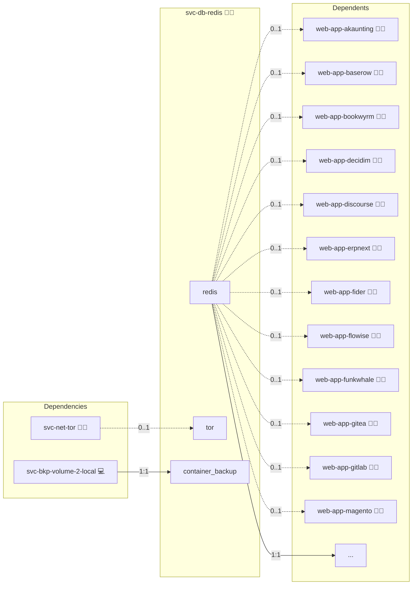

# Redis

## Description

This Ansible role provides Redis in two interchangeable shapes, selected per consumer with the `shared` flag (mirroring `svc-db-postgres`):

- **Central** (`enabled: true`, `shared: true`): a Redis stack that many roles share through the `default` user. One host renders the standalone form; three or more hosts in the `svc-db-redis` inventory group on Swarm render the HA form with Sentinel.
- **Embedded** (`enabled: true`, `shared: false`): a Redis sidecar rendered into the consumer's own compose stack via `templates/service.yml.j2`.

## Overview

The standalone central stack (`templates/compose.yml.j2`) runs `redis:alpine` from flags, with no configuration file and no Sentinel:

- `requirepass` for the `default` user, sourced from the `REDIS_PASSWORD` credential.
- AOF persistence for cached data.
- A `maxmemory` ceiling derived from the service `mem_limit` with an `allkeys-lru` policy.
- A bind on `127.0.0.1:6379` plus the shared cross-stack overlay network for consumers.

Applications share the `default` user; there are no per-application users.

## High Availability (alpha)

The HA form is `lifecycle: alpha`. It renders when the `svc-db-redis` group lists three or more Swarm nodes:

- One Redis instance per host (`redis-<host-id>`, pinned to that host, volume `redis_data_<host-id>`; the original host keeps `redis_data`).
- One Sentinel per instance host (`redis-sentinel-<host-id>`, same `redis` image, port 26379, `0.1` CPU / `32m` / `64m`), with its own small volume for its rewritable `sentinel.conf`. Settings: quorum 2, `down-after-milliseconds 5000`, `failover-timeout 10000`, `parallel-syncs 1`, `resolve-hostnames yes`, `announce-hostnames yes`. Every instance and Sentinel announces its service name.
- An HAProxy write endpoint that takes over the `redis` service and the `redis-central` alias. Its check logs in as `haproxy-check` and expects `role:master` and `connected_slaves:[1-9]`, so `lookup('engine', 'redis', …)` consumers need no change.

Configuration has two owners:

- `infinito.conf`, rendered by Ansible on every run and delivered as a Swarm secret: the `default`, `sentinel` and `haproxy-check` ACL users, `masterauth`, `maxmemory` (80 % of `mem_limit`, `allkeys-lru`), RDB and AOF, `min-replicas-to-write 1` and `min-replicas-max-lag 10`.
- `/data/redis.conf`, seeded only when absent with an `include` of the file above. Sentinel's `replicaof` rewrites persist there. On every start the wrapper drops any line the include owns, so `CONFIG REWRITE` cannot freeze an old password or limit into it.

The start-up wrapper (`files/shell/ha_start.sh`) asks the Sentinels for the current master and takes the majority answer. If another instance is master, it starts as that instance's replica; if no Sentinel answers, it keeps the role in its configuration file. A fresh non-bootstrap instance is seeded as a replica of the bootstrap instance (the original host).

Instances keep running as the image's default user, like the standalone form, so that the legacy volume is adopted without a change of ownership. Sentinels run as `redis` with a read-only root filesystem, no Docker socket and no extra capabilities. Every Sentinel sets `requirepass` to the `sentinel` user's password (`REDIS_SENTINEL_PASSWORD`, delivered as a Docker secret), so clients, peers and Ansible authenticate; the scripts pass it through `REDISCLI_AUTH`, never argv.

Networks: the application-facing overlay with the `redis-central` alias is joined only by HAProxy. Instances, Sentinels and HAProxy share the stack-scoped, encrypted `internal` overlay (`meta/networks.yml` `internal.subnet`). No port is published.

Sizing: an instance reserves 128 MiB (limit 512 MiB), a Sentinel 32 MiB (limit 64 MiB), HAProxy 64 MiB (limit 128 MiB). The per-node arithmetic for all engines is in the `svc-db-postgres` README.

### Guarantee

| Engine | Tier | One node lost | Partitioned old master |
|---|---|---|---|
| Redis | best-effort | at most 10 s of acknowledged writes lost | stops writing after `min-replicas-max-lag` 10 s |

Writes also stop while no replica is connected. Redis is not backed up, in either form.

### Runbooks

- **Migrating from standalone:** add the hosts to the `svc-db-redis` group and re-run. The original host's instance starts in HA form on the legacy `redis_data` volume with its data in place, its configuration seeded from today's flags, and the other instances resync from it. Expect a short write outage.
- **Rolling upgrade:** an image change is rolled by the deploy: before the stack deploy, `sys-svc-compose` moves the Sentinels, then the replicas, to the new image one at a time (each converged and healthy before the next), runs `SENTINEL FAILOVER redis`, waits until `SENTINEL get-master-addr-by-name redis` names another instance, then moves the old master. For other restart-requiring changes follow the same order by hand, with `REDISCLI_AUTH` set to the Sentinel password.
- **Losing a host:** the remaining Sentinels promote a replica within about 11 s. Replace the host by listing a new one in the group and re-running; it starts empty and does a full resync. Run `SENTINEL RESET redis` on every Sentinel after forgetting a node.
- **Who is master:** `REDISCLI_AUTH=<sentinel password> redis-cli -h redis-sentinel-<host-id> -p 26379 SENTINEL get-master-addr-by-name redis`.

The embedded snippet (`templates/service.yml.j2`) keeps the previous single-host behaviour: an unauthenticated in-memory Redis attached to the consumer stack's default network. Its `maxmemory` is 80 % of the consumer's `services.redis.mem_limit`; a consumer that declares none gets 80 % of the limit its container inherits, at most 80 % of this role's own `mem_limit`.

## Cosmos

The diagram places Redis in the Infinito.Nexus cosmos: the components it deploys (capabilities), the central services it consumes (dependencies), and its outward reach (federation and bridged external networks).



Solid `1:1` edges are fixed relationships; dashed `0..1` edges are conditional (enabled only in matching deployments); red `0..0` edges are turned off in this role. Node markers show the role's deploy modes (💻 host, 🐳 compose, 🐝 swarm); ❌ marks a service that is explicitly turned off, and ⚙️ an Ansible role dependency declared in `meta/main.yml`.

## Features

- **Central or embedded** selected per consumer via `services.redis.shared`.
- **Sentinel HA (alpha)** three instances and three Sentinels behind an HAProxy write endpoint on Swarm.
- **Node-local state** on-disk state stays node-local (never on NFS) in swarm.
- **Built-in healthcheck** authenticated `redis-cli ping`.

## Quick Setup

### Development

Clone, set up the workstation, and deploy Redis onto the local stack:

```bash
git clone https://github.com/infinito-nexus/core.git
cd core
make onboard
make compose-deploy mode=reinstall apps=svc-db-redis full_cycle=false
```

### Production

Run the published image to provision the inventory and deploy Redis to a managed server (the mounted volume persists the inventory):

```bash
APP=svc-db-redis
HOST=<your-server>
DOMAIN=<your-domain>
TLS_MODE=self_signed
SSH_PUBLIC_KEY="<your-ssh-public-key>"

docker run --rm -it \
  -v "$PWD/inventories:/etc/infinito.nexus/inventories" \
  -e APP="$APP" -e HOST="$HOST" -e DOMAIN="$DOMAIN" -e TLS_MODE="$TLS_MODE" -e SSH_PUBLIC_KEY="$SSH_PUBLIC_KEY" \
  ghcr.io/infinito-nexus/core/debian bash -c '
    INVENTORY=/etc/infinito.nexus/inventories/production
    infinito administration inventory provision "$INVENTORY" \
      --inventory-file "$INVENTORY/devices.yml" \
      --host "$HOST" \
      --include "$APP" \
      --vars "{\"TLS_MODE\": \"$TLS_MODE\", \"DOMAIN_PRIMARY\": \"$DOMAIN\", \"users\": {\"administrator\": {\"authorized_keys\": [\"$SSH_PUBLIC_KEY\"]}}}" &&
    infinito administration deploy dedicated "$INVENTORY/devices.yml" \
      --password-file "$INVENTORY/.password" \
      --diff -vv'
```

## Further Resources

- [Official Redis Docker image on Docker Hub](https://hub.docker.com/_/redis)
- [Redis ACL documentation](https://redis.io/docs/latest/operate/oss_and_stack/management/security/acl/)
- [Docker Compose reference](https://docs.docker.com/compose/compose-file/)

## Credits

Implemented by **[Kevin Veen-Birkenbach](https://www.veen.world)**.
Part of the [Infinito.Nexus Project](https://s.infinito.nexus/code) and maintained by [Kevin Veen-Birkenbach](https://www.veen.world).
Licensed under the [Infinito.Nexus Community License (Non-Commercial)](https://s.infinito.nexus/license).
