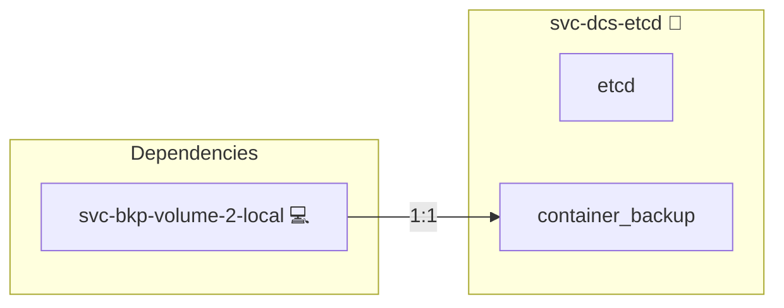

# etcd

## Description

This Ansible role runs the shared etcd coordination store that the central database clusters use for leader election on Docker Swarm: Patroni (Postgres) and the writer elector (MariaDB, OpenLDAP).

etcd is Swarm-only infrastructure the project owns. On Kubernetes the database operators and Lease objects replace it, so this role renders nothing in compose mode and nothing on Kubernetes.

## Overview

- **Deployed only when needed:** the role runs only in Swarm mode and only when at least one central engine (`svc-db-postgres`, `svc-db-mariadb`, `svc-db-redis`, `svc-db-openldap`) runs in its HA form. Standalone installs get no etcd.
- **Instance model:** one member per host in the `svc-dcs-etcd` inventory group, each a separate Swarm service `etcd-<host-id>` with `replicas: 1`, pinned to its host and holding its own node-local volume. When the group is empty it defaults to the `svc-swarm-manager` hosts. Inventory validation allows 1 member or an odd number of at least 3.
- **Static bootstrap:** the `--initial-cluster` list is rendered from the member list.
- **Lifecycle:** `alpha`. It is promoted to beta only once the failover suite and the HA rows of the CI topology axis are green, with Tor, at the HA size.

## Cosmos

The diagram places etcd in the Infinito.Nexus cosmos: the components it deploys (capabilities), the central services it consumes (dependencies), and its outward reach (federation and bridged external networks).



Solid `1:1` edges are fixed relationships; dashed `0..1` edges are conditional (enabled only in matching deployments); red `0..0` edges are turned off in this role. Node markers show the role's deploy modes (💻 host, 🐳 compose, 🐝 swarm); ❌ marks a service that is explicitly turned off, and ⚙️ an Ansible role dependency declared in `meta/main.yml`.

## Features

- **Swarm-only coordination store** for Patroni and the writer elector, deployed only when an engine runs in HA form.
- **One member per host**, pinned, with a node-local data volume.
- **TLS everywhere** from an Ansible-generated CA, with peer certificate authentication.
- **Prefix-scoped users** for every consumer, reconciled on each deploy.
- **No backups by design:** an empty store plus a re-run recovers.

## Quick Setup

### Development

Clone, set up the workstation, and deploy etcd onto the local stack:

```bash
git clone https://github.com/infinito-nexus/core.git
cd core
make onboard
make compose-deploy mode=reinstall apps=svc-dcs-etcd full_cycle=false
```

### Production

Run the published image to provision the inventory and deploy etcd to a managed server (the mounted volume persists the inventory):

```bash
APP=svc-dcs-etcd
HOST=<your-server>
DOMAIN=<your-domain>
TLS_MODE=self_signed
SSH_PUBLIC_KEY="<your-ssh-public-key>"

docker run --rm -it \
  -v "$PWD/inventories:/etc/infinito.nexus/inventories" \
  -e APP="$APP" -e HOST="$HOST" -e DOMAIN="$DOMAIN" -e TLS_MODE="$TLS_MODE" -e SSH_PUBLIC_KEY="$SSH_PUBLIC_KEY" \
  ghcr.io/infinito-nexus/core/debian bash -c '
    INVENTORY=/etc/infinito.nexus/inventories/production
    infinito administration inventory provision "$INVENTORY" \
      --inventory-file "$INVENTORY/devices.yml" \
      --host "$HOST" \
      --include "$APP" \
      --vars "{\"TLS_MODE\": \"$TLS_MODE\", \"DOMAIN_PRIMARY\": \"$DOMAIN\", \"users\": {\"administrator\": {\"authorized_keys\": [\"$SSH_PUBLIC_KEY\"]}}}" &&
    infinito administration deploy dedicated "$INVENTORY/devices.yml" \
      --password-file "$INVENTORY/.password" \
      --diff -vv'
```

## Security

- **TLS:** client and peer traffic use TLS. Ansible generates a dedicated coordination-store CA on the stack host and signs one member certificate whose SANs list every member, `etcd`, `localhost` and `127.0.0.1`. Peers must present a certificate from that CA (`--peer-client-cert-auth`). The peer's address is not matched against the certificate SANs (`--peer-skip-client-san-verification`): a peer connects from its task IP, which Swarm's DNS cannot reverse-resolve, so the SAN check rejects every peer; the private CA is the trust boundary. Clients authenticate by user and password, not by certificate, so the client listener carries no `--trusted-ca-file`: etcd turns any client CA into a required client certificate. A change of the member set re-signs the certificate. The CA is separate from `sys-ca-selfsigned`, which is minted only for self-signed front-end TLS and is injected into application containers as a trust anchor; etcd must not trust, or be trusted by, anything outside the database stacks.
- **Authentication:** on, with the `root` password from the inventory. One user per consumer, each holding a role restricted to its key prefix. Each consumer declares its user and prefix under `services.etcd.user` / `services.etcd.prefix` in its own `meta/services.yml`; this role discovers them and reads the password from its credential `ETCD_<USER>_PASSWORD`. Today's consumers:

  | User | Prefix |
  |---|---|
  | `patroni` | `/service/` |
  | `mariadb-elector` | `/infinito/mariadb/` |
  | `openldap-elector` | `/infinito/openldap/` |

  Users, roles and passwords are reconciled on every deploy with `etcdctl` run through `container exec` on the first member's host.
- **Credentials:** declared in `meta/secrets.yml` `credentials:` and delivered as `type: secret` entries in `meta/volumes.yml`, mounted under `/run/secrets/etcd/`.
- **Network:** etcd sits on its own encrypted overlay, which only the database stacks join. No port is published.
- **Container hardening:** read-only root filesystem, no Docker socket, every capability dropped (`cap_drop: [ALL]`; root-owned files stay readable to their root owner without `CAP_DAC_OVERRIDE`). Exception: the official image is distroless and runs as root, because the Swarm-created data volume is root-owned and the image has no shell to change its ownership before dropping privileges.

## Image

The image is the etcd project's official release image, `gcr.io/etcd-development/etcd`, pinned to an exact 3.6.x patch. The release process publishes to it first; `quay.io/coreos/etcd` is a mirror of the same build.

## Sizing

Each member declares `cpus: 0.5`, `mem_reservation: 256m`, `mem_limit: 512m`. The per-node arithmetic for all database engines is in the `svc-db-postgres` README.

## Upgrades

An image bump rolls one member at a time: before the stack deploy, `sys-svc-compose` moves each member to the new image and waits until it is converged and healthy before the next, so quorum holds throughout. A bump merges only when the failover suite is green.

The members run without a container healthcheck (`test: ["NONE"]`). Swarm routes a service name only to healthy tasks, and etcd answers no client request, `endpoint status` included, before it has joined a quorum, so any probe keeps every member of a fresh cluster unreachable to its peers and the cluster never forms. Quorum is checked by the role instead: it waits until `auth status` answers before it touches users and roles.

## Disaster recovery

etcd is not backed up: it holds no source data. Ansible re-applies Patroni's configuration on every run and leader keys rebuild themselves. When the whole store is lost:

1. remove the etcd stack and its member volumes (`etcd_data`, `etcd_data_<host-id>`);
2. re-run the deploy; it bootstraps an empty cluster and re-creates users, roles and authentication.

When etcd loses quorum, Patroni keeps its primary only through `failsafe_mode` while it reaches every member, and the writer elector fails closed (MariaDB `read_only=1`, OpenLDAP `olcReadOnly: TRUE`).

## Further Resources

- [etcd documentation](https://etcd.io/docs/)
- [etcd authentication guide](https://etcd.io/docs/v3.6/op-guide/authentication/rbac/)
- [etcd transport security](https://etcd.io/docs/v3.6/op-guide/security/)

## Credits

Implemented by **[Alejandro Roman](https://github.com/AlejandroRomanIbanez)**.
Part of the [Infinito.Nexus Project](https://s.infinito.nexus/code) and maintained by [Kevin Veen-Birkenbach](https://www.veen.world).
Licensed under the [Infinito.Nexus Community License (Non-Commercial)](https://s.infinito.nexus/license).
